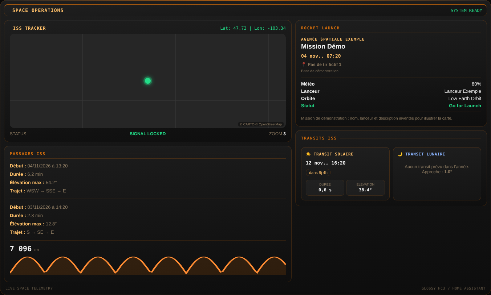
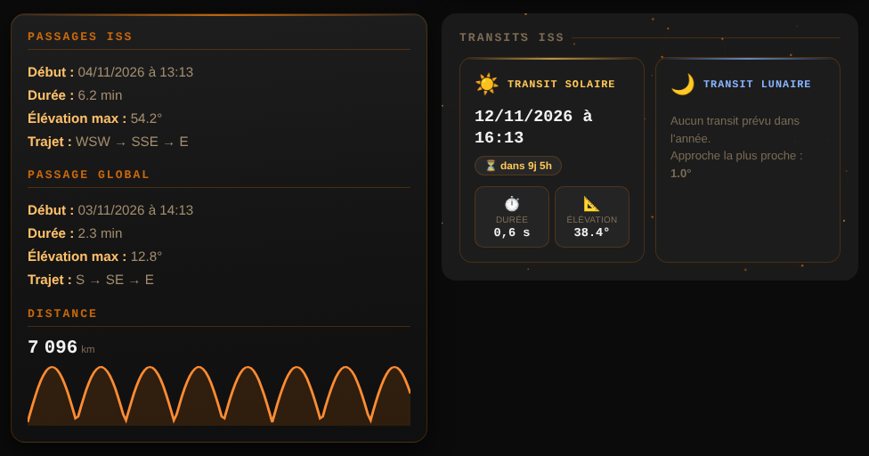
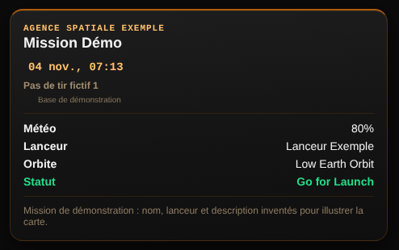

<p>
  ☕ <strong>Si cette carte vous est utile, vous pouvez soutenir le projet :</strong>
</p>

<div style="white-space: nowrap; line-height: 0;">
  <a
    href="https://www.buymeacoffee.com/Marlboro62"
    target="_blank"
    rel="noopener noreferrer"
    style="display: inline-block; text-decoration: none; vertical-align: middle;"
  ></a>&nbsp;&nbsp;<a
    href="https://ko-fi.com/M4M2QL45X"
    target="_blank"
    rel="noopener noreferrer"
    style="display: inline-block; text-decoration: none; vertical-align: middle;"
  ></a>
</div>

# Cartes ISS et espace

**Cinq cartes Lovelace dans un seul fichier**, aux couleurs des autres cartes ([Météo](https://github.com/Marlboro62/meteo-card), [Carte Enedis Linky New](https://github.com/Marlboro62/content-card-linky-new)…) : bleu nuit par défaut, version claire, ou thème Home Assistant :

| Type | Carte |
| --- | --- |
| `custom:glossy-space-dashboard-card` | **Space Operations** : les quatre cartes ci-dessous réunies en un seul tableau de bord, avec une seule configuration |
| `custom:glossy-iss-tracker-card` | **ISS Tracker** : position de l'ISS en direct, latitude et longitude, sur une mini-carte sombre |
| `custom:glossy-iss-passes-card` | **Passages ISS** : prochain passage visible et prochain passage global (début, durée, élévation, trajet), graphique de la distance |
| `custom:glossy-iss-transit-card` | **Transits ISS** : prochains passages de l'ISS devant le Soleil et la Lune, avec compte à rebours |
| `custom:glossy-launch-card` | **Prochain lancement** : agence, mission, date (rouge clignotant juste avant le décollage), pas de tir, météo, lanceur, orbite, statut |

**Rien à installer** : sans capteur configuré, les cartes font tout elles-mêmes, dans le navigateur. Ni intégration, ni package YAML, ni clé N2YO. Toutes ont un **éditeur visuel**.

- **ISS** : position, distance, prochains passages et **transits devant le Soleil et la Lune**, calculés par la carte.
- **Prochain lancement** : lu sur [Launch Library 2](https://thespacedevs.com/llapi) (The Space Devs), gratuit et sans clé, la source de l'intégration Next Launch. Une requête toutes les 30 minutes, partagée par toutes les cartes.

### Calcul intégré de l'ISS

- **Éléments orbitaux** (TLE) de l'ISS téléchargés depuis [CelesTrak](https://celestrak.org/), ou [wheretheiss.at](https://wheretheiss.at/) en secours : gratuits, sans clé, rafraîchis toutes les 6 heures et gardés dans le navigateur. Une seule requête pour toutes les cartes.
- **Position** calculée toutes les 5 secondes avec le modèle SGP4, celui de N2YO et de CelesTrak.
- **Passages** des 10 prochains jours depuis le **lieu de Home Assistant** (Paramètres › Système › Général) :
  - le **prochain passage visible à l'œil nu** : ISS éclairée par le Soleil, ciel noir chez vous (Soleil à plus de 6° sous l'horizon), au moins 2 minutes, comme N2YO ;
  - le **prochain passage global** : au-dessus de la hauteur minimale, de jour comme de nuit.
- **Distance** au sol entre chez vous et le point sous l'ISS, avec la courbe des dernières heures.
- **Transits** des 14 prochains jours : passages de l'ISS devant le disque du Soleil ou de la Lune vus de chez vous (position de la Lune d'après Meeus), avec la durée, la hauteur et la distance de l'ISS. Sans transit, l'approche la plus proche, en degrés.

Un transit ne se voit que sur une bande de quelques kilomètres de large, et l'orbite de l'ISS change à chaque correction : vérifiez l'heure exacte la veille sur un site spécialisé avant d'aller observer.

Votre position reste dans votre navigateur : elle n'est envoyée à aucun service.

Vous avez déjà des capteurs (par exemple un package N2YO) ? Renseignez-les dans la carte : elle les lit à la place du calcul intégré.

Option commune à toutes les cartes, `theme` (« Couleurs de la carte » dans l'éditeur) :

| Valeur | Couleurs |
| --- | --- |
| `v2` (défaut) | Bleu nuit, comme les autres cartes |
| `auto` | Bleu nuit, ou version claire quand Home Assistant est en mode clair |
| `ha` | Couleurs du thème Home Assistant (clair ou sombre) |



## Installation

### Avec HACS (recommandé)

1. Dans HACS, menu **⋮** → **Dépôts personnalisés**.
2. Ajoutez `https://github.com/Marlboro62/ISS` avec le type **Tableau de bord** (Dashboard).
3. Cherchez **Cartes ISS et espace**, installez, puis rechargez la page (Ctrl+F5).

### Manuellement

1. Téléchargez [`iss-cards.js`](https://raw.githubusercontent.com/Marlboro62/ISS/main/dist/iss-cards.js) et [`iss-cards-maps.js`](https://raw.githubusercontent.com/Marlboro62/ISS/main/dist/iss-cards-maps.js) (clic droit → Enregistrer sous) et copiez-les **tous les deux** dans `/config/www/` : le second contient MapLibre GL, chargé par la mini-carte.
2. **Paramètres → Tableaux de bord → ⋮ → Ressources → Ajouter une ressource** : URL `/local/iss-cards.js`, type **Module JavaScript**.
3. Rechargez la page (Ctrl+F5).

> Vous aviez les fichiers séparés (`glossy-iss-tracker-card.js`, `glossy-space-dashboard-card.js`…) ? Les types de carte n'ont pas changé : supprimez simplement les anciennes ressources et gardez celle-ci. Vos tableaux de bord restent tels quels.

## Space Operations — `custom:glossy-space-dashboard-card`

Les quatre cartes en un seul tableau de bord : bandeau de titre, ISS Tracker (avec le statut du signal et le niveau de zoom), passages, prochain lancement et transits. Sur deux colonnes quand la carte est large, sur une seule quand elle est étroite (colonne d'un tableau de bord, téléphone).

```yaml
type: custom:glossy-space-dashboard-card
title: SPACE OPERATIONS
tracker:
  zoom_span: 40
passes:
  min_elevation: 10
launch:
  imminent_minutes: 15
```

Sans entité, chaque section est remplie par le calcul intégré ou par Launch Library 2.

Les sections `tracker`, `passes`, `launch` et `transits` prennent les mêmes options que les cartes séparées, décrites ci-dessous. `title` change le titre du bandeau, `theme` les couleurs de tout le tableau de bord.

## ISS Tracker — `custom:glossy-iss-tracker-card`

```yaml
type: custom:glossy-iss-tracker-card
```

- Position de l'ISS (latitude et longitude) dans le bandeau, **en vert** quand le capteur répond, **en rouge clignotant** quand le signal est perdu.
- **Mini-carte** centrée sur l'ISS, **sans clé** : fond vectoriel [OpenFreeMap](https://openfreemap.org/) (gratuit, sans clé), sombre ou clair selon le thème, affiché avec MapLibre GL livré avec les cartes (aucun CDN). Une clé gratuite [Stadia Maps](https://client.stadiamaps.com/) ou [CARTO](https://carto.com/basemaps/apikey) reste possible pour leurs propres fonds. Les fonds CARTO sans clé, ceux de la carte de Home Assistant, ne sont plus utilisés : ils portent désormais un filigrane « API KEY REQUIRED » ([home-assistant/frontend#53800](https://github.com/home-assistant/frontend/issues/53800)).

| Option | Rôle | Défaut |
| --- | --- | --- |
| `entity` | Facultatif. Capteur dont les attributs `latitude` et `longitude` donnent la position. Vide : position calculée par la carte | — |
| `status_entity` | Capteur qui décide du vert ou du rouge | `entity` |
| `lat_entity`, `lon_entity` | Capteurs de repli si les attributs de position manquent | — |
| `zoom_span` | Largeur de la vue, en degrés | `40` |
| `stadia_api_key` | Facultatif : clé Stadia Maps (prioritaire) | — |
| `carto_api_key` | Facultatif : clé CARTO | — |

## Passages ISS — `custom:glossy-iss-passes-card`



```yaml
type: custom:glossy-iss-passes-card
```

Sans entité, tout est calculé par la carte. Avec vos propres capteurs :

```yaml
type: custom:glossy-iss-passes-card
visible_readable_entity: sensor.iss_prochain_passage_visible_lisible
visible_attrs_entity: sensor.iss_prochain_passage_visible
global_readable_entity: sensor.iss_prochain_passage_global_lisible
global_attrs_entity: sensor.iss_prochain_passage_global
distance_entity: sensor.distance_iss
```

- **Prochain passage visible** et **prochain passage global** : début, durée, élévation maximale, trajet (direction d'apparition, de culmination et de disparition).
- **Distance** de l'ISS, avec le graphique de son historique.

| Option | Rôle | Défaut |
| --- | --- | --- |
| `title` | Titre | `Passages ISS` |
| `visible_readable_entity` | Capteur dont l'état est la date du passage visible, déjà mise en forme | — |
| `visible_attrs_entity` | Capteur dont les attributs donnent `duration` (en secondes), `maxEl`, `startAzCompass`, `maxAzCompass`, `endAzCompass` | — |
| `global_readable_entity`, `global_attrs_entity` | Les mêmes, pour le passage global | — |
| `distance_entity` | Capteur de distance de l'ISS, en km | — |
| `distance_hours` | Heures d'historique du graphique | `12` |
| `min_elevation` | Calcul intégré : hauteur minimale d'un passage au-dessus de l'horizon, en degrés | `10` |
| `min_visible` | Calcul intégré : durée minimale à l'œil nu d'un passage visible, en secondes | `120` |

Dès qu'un capteur est renseigné, la carte n'affiche que les sections dont le capteur est configuré.

## Transits ISS — `custom:glossy-iss-transit-card`

```yaml
type: custom:glossy-iss-transit-card
```

- Date du prochain **transit solaire** et **lunaire**, compte à rebours, durée, élévation, et distance de l'ISS pour la Lune.
- Sans transit prévu, l'approche la plus proche.
- **Sans entité**, les transits sont calculés par la carte sur les 14 prochains jours (voir [Calcul intégré de l'ISS](#calcul-intégré-de-liss)).

Avec vos propres capteurs :

```yaml
type: custom:glossy-iss-transit-card
solar_entity: sensor.iss_next_solar_transit
lunar_entity: sensor.iss_next_lunar_transit
```

| Option | Rôle | Défaut |
| --- | --- | --- |
| `title` | Titre | `Transits ISS` |
| `solar_entity`, `lunar_entity` | Capteurs dont les attributs donnent `date`, `duration_seconds`, `max_elevation_deg`, `iss_distance_km`, `closest_approach_deg` | — |

> Observer un transit solaire demande un **filtre solaire homologué** : ne regardez jamais le Soleil sans protection, ni à l'œil nu ni avec un instrument.

## Prochain lancement — `custom:glossy-launch-card`



**Sans entité**, la carte lit le prochain lancement sur Launch Library 2 :

```yaml
type: custom:glossy-launch-card
```

Avec les capteurs de l'intégration HACS **Next Launch** :

```yaml
type: custom:glossy-launch-card
entity: sensor.next_launch_prochain_lancement
mission_entity: sensor.next_launch_mission_de_lancement
date_entity: sensor.next_launch_date_de_lancement
probability_entity: sensor.next_launch_probabilite_de_lancement
status_entity: sensor.next_launch_statut_de_lancement
```

| Option | Rôle | Défaut |
| --- | --- | --- |
| `entity` | Capteur principal (attributs `provider`, `pad`, `facility`) | — |
| `mission_entity` | Mission (attributs `target_orbit`, `rocket_name`, `description`) | — |
| `date_entity` | Date et heure du lancement | — |
| `probability_entity` | Probabilité météo, en % | — |
| `status_entity` | Statut (vert quand il contient « Go ») | — |
| `imminent_minutes` | Sous ce délai avant le décollage, la carte passe en rouge clignotant | `15` |

## Support

Questions et problèmes : uniquement via les [issues GitHub](https://github.com/Marlboro62/ISS/issues).

## Voir aussi

[Cartes Météo](https://github.com/Marlboro62/meteo-card) · [Cartes Serveur HA](https://github.com/Marlboro62/serveur-ha-card) · [Carte Enedis Linky New](https://github.com/Marlboro62/content-card-linky-new)

## Licence

MIT

## Nom du projet et forks

Ce dépôt est la seule source officielle de **Cartes ISS et espace** (releases, HACS, support),
maintenu par [Marlboro62](https://github.com/Marlboro62).

La licence MIT autorise à copier, modifier et redistribuer le code. Si vous publiez une version modifiée :

- gardez les mentions de copyright du fichier [`LICENSE`](https://github.com/Marlboro62/ISS/blob/main/LICENSE) (© Marlboro62) ;
- **donnez-lui un autre nom** et d'autres types de carte (`custom:glossy-space-dashboard-card`, `custom:glossy-iss-tracker-card`, `custom:glossy-iss-passes-card`,
  `custom:glossy-iss-transit-card` et `custom:glossy-launch-card` sont ceux de ce dépôt) :
  Home Assistant ne peut pas charger deux cartes du même type, et personne ne doit confondre les deux versions dans HACS ;
- ne la présentez pas comme la version officielle et n'orientez pas vers ce dépôt les demandes
  de support qui concernent votre version.

Une correction ou une idée ? Les **pull requests** et les **issues** sont les bienvenues ici :
elles profitent à tous les utilisateurs.
